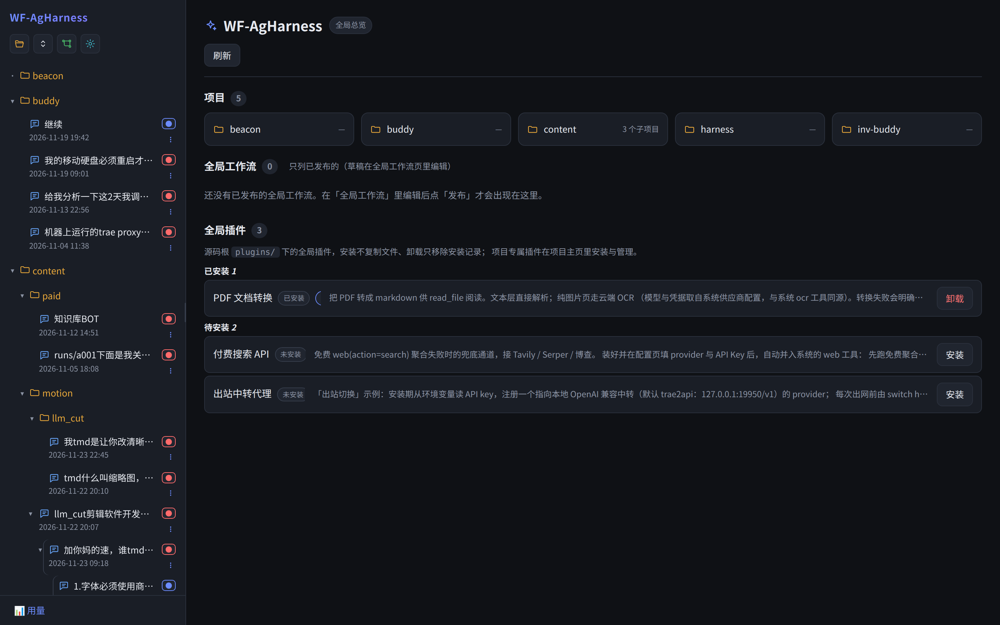
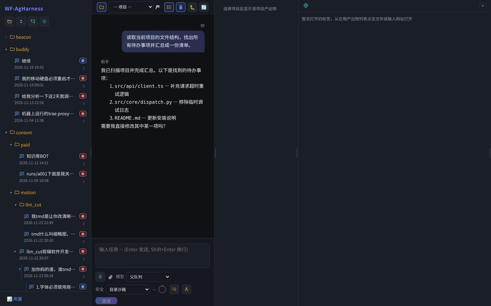
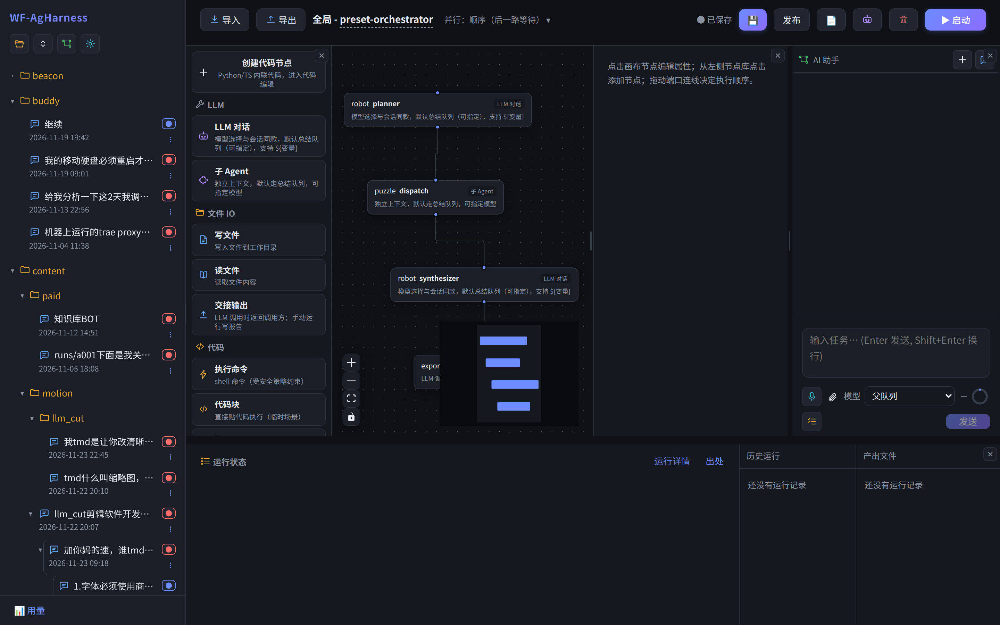
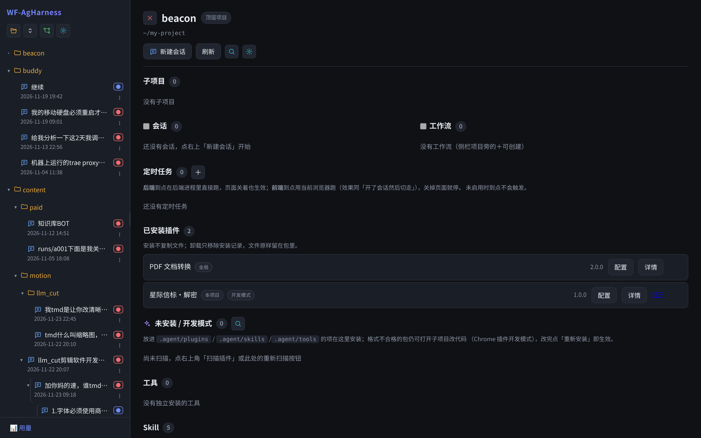
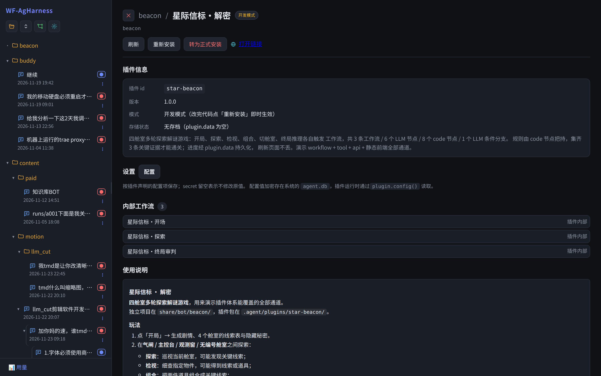
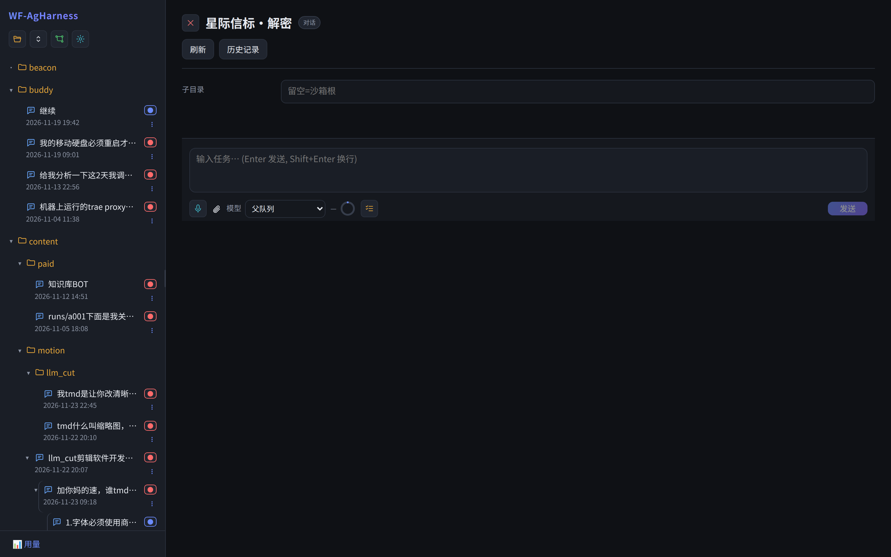
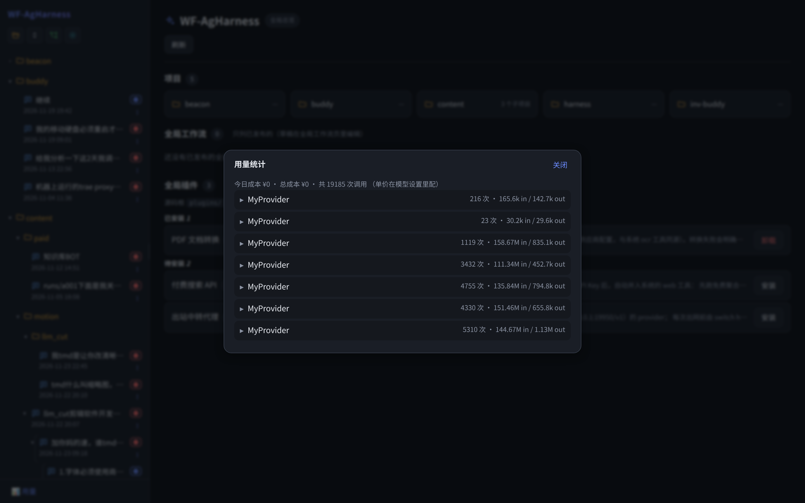

# WF AgHarness

**一个装在你电脑里的 AI 工作台。** 在同一个聊天窗口里，让 AI 帮你读写文件、查资料、跑流程、写工具——所有数据都留在你自己的机器上。

> 核心引擎 **Apache-2.0 开源**， freely use / 修改 / 商用都欢迎。想要开箱即用的成品 Bot、企业版与定制服务，见文末。

---

## 一眼看懂它能做什么

| 你想要的事 | 在 WF AgHarness 里怎么做 |
|:---|:---|
| 让 AI 帮忙改代码、整理文件 | 直接用大白话下指令，AI 会在你确认后动手 |
| 查资料、读网页 | 让它联网搜索、抓网页正文，能看懂需要脚本渲染的网页 |
| 反复跑一套固定流程 | 用可视化工作流把步骤连起来，存一次，以后一点就跑 |
| 多个 AI 分工协作 | 在工作流里编排「规划 / 执行 / 复核」多个 Agent，各管一段 |
| 把自家文档变成问答机器人 | 文档丢进知识库，之后直接问它 |
| 扩展专属能力 | 装插件、写脚本、接外部工具，都能插进来 |

---

## 功能一览（真实界面）

### 1. 像聊天一样干活

这是你每天打开就会用的主界面。左边是项目和会话，中间是对话，右边能看到 AI 产出的文件。你只需要说人话——「把这个项目里的 TODO 挑出来」「给这段视频写个封面标题」——AI 自己去读文件、找资料、改东西，写操作会先问你一句。

### 2. 多 Agent 工作流，把「一次性对话」变成「可复用的流水线」

这是 WF AgHarness 和普通聊天工具最大的不同。你可以像搭积木一样，把「AI 节点」「代码节点」「子 Agent」「条件分支」「循环」拖到画布上连起来。比如内置的「编排者」模式：一个主 Agent 拆任务，分给几个子 Agent 并行干，最后再汇总——整个过程可复现、可保存、可反复运行。

内置三种协作范式，开箱即用：
- **流水线**：上一个 Agent 的输出直接喂给下一个；
- **辩论**：两个 Agent 各执一词，第三个来裁决；
- **编排者**：一个主 Agent 分配任务、汇总结果。

### 3. 项目主页：每个项目都有自己的会话、流程和插件

每个项目是一个独立的工作空间，有自己的对话、工作流、定时任务、插件和知识文件。互不串味，切换项目就像切换不同的工作台。

### 4. 插件：把任何能力装进来

工具、技能包、带界面的小应用，都能作为插件安装。截图里是一个用「工作流 + 插件页面」搭的解谜 Bot：规则由代码节点把持，剧情由 AI 生成，进度会自动保存——刷新页面也不会丢。这说明插件不只是个按钮，而是能装下一整套带交互的应用。

想自己写一个？跟着 [插件开发文档](docs/PLUGIN_DEV_GUIDE.md) 走一遍就行。

### 5. 用量一目了然

用了多少、花了多少，随时能看，没有隐藏账单。

### 6. 其他同样好用的能力

- **知识库问答**：PDF、网页、文字丢进去，之后直接问它，答案只基于你的资料。
- **多模型随你切**：不同模型配不同任务，聊天时下拉一选就换。
- **图片 / 语音**：能看懂图片里的字、听懂语音，也能按描述生成图片。
- **安全可控**：所有工具调用都经过策略开关，敏感操作要你点头；数据默认只存本机。

---

## 为什么选 WF AgHarness，而不是那些大块头

市面上不少 AI 工具（如 WorkBuddy、Trae、豆包客户端等）好用是好用，但普遍有两个毛病：**重**，开机就吃掉好几个 G 的内存、CPU 长期高负载；**吵**，后台不停写日志、磁盘哗哗响。

WF AgHarness 走的是另一条路：

| | 常见大块头 | **WF AgHarness** |
|:---|:---|:---|
| 内存占用 | 动辄 2–5 GB | **一个零头**，老机器也跑得动 |
| CPU 消耗 | 高负载、风扇狂转 | **低一个数量级**，安静待命 |
| 磁盘写入 | 大量日志持续写盘 | **不搞海量日志刷盘**，只在必要时存数据 |
| 工作流 | 大多没有，或很弱 | **可视化工作流，可复用、可编排** |
| 多 Agent | 概念多、落地难 | **画布上搭出来就能跑** |
| Bot / 插件 | 生态封闭 | **开放插件体系，自己写或装现成的** |
| 数据归属 | 多在云端 | **本地运行，数据不出机** |

一句话：**把花哨的包装省下来，把算力留给真正干活的 AI。** 配置普通的电脑、笔记本，甚至老机器，都能顺畅使用。

---

## 开源、许可与商务

- 核心引擎以 **Apache-2.0** 开源（见 [LICENSE](LICENSE)）：可自由使用、修改、商用，可基于它做自己的产品，也可编写和分发插件；请保留版权与许可声明。
- 公开仓库提供**完整、可编译的源码**以及 [使用手册](docs/USAGE.md)、[安装部署](docs/INSTALL.md)、[插件开发](docs/PLUGIN_DEV_GUIDE.md) 文档。
- “WF AgHarness”名称与标识为项目方商标；修改版可自由分发，但请勿以官方名义署名（见 [NOTICE](NOTICE)）。

**想要省事的成品？**（以下为付费服务）
- **垂直 AI Bot / 知识库问答**：客服、文档问答、销售辅助等场景，装好即用；
- **私有化与企业版**：多账号、权限隔离、审计合规、内网离线部署；
- **定制插件 / 工作流**：按你的业务接系统、写工具、编排流程；
- **技术咨询与培训**。

开源核心永远免费；付费的只是「成品与省事的服务」。有需求可通过下方二维码联系我们，或在 Issues 里标注「商务咨询」。

---

## 关注我们（扫码）

| 视频号 | 公众号 | 抖音 |
|:---:|:---:|:---:|
|  |  |  |
| 视频号二维码 | 公众号二维码 | 抖音二维码 |

---

## 参与 & 文档

- 文档：[使用手册](docs/USAGE.md) · [安装部署](docs/INSTALL.md) · [插件开发](docs/PLUGIN_DEV_GUIDE.md)
- Issues / Discussions：`https://github.com/xslower/WF-AgHarness/issues`
- 本仓库为唯一官方源。

*如果 WF AgHarness 帮到了你，欢迎点个 Star，这是最大的支持。*
