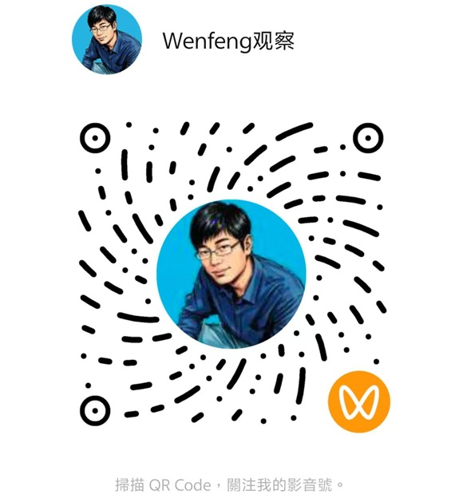

# Agent Harness

**浏览器里的 AI Agent 工作台**：在一个对话框里驱动文件操作、网页搜索、代码执行与工作流编排。本地 / 自托管，数据不出你的机器。

> 核心框架 **Apache-2.0 真开源**，可自由使用、修改、商用；定制开发、垂直 bot 与托管服务见文末。

---

## 一、快速开始（最省事的三种方式）

### 方式 A：下载解压即用（推荐，无需装 Python / Node）

1. 到 [Releases](../../releases) 下载对应系统的包（当前提供 `linux-x86_64`，Windows / macOS 见 Releases 或自行构建）。
2. 解压后一键启动：

   ```bash
   # Linux / macOS
   ./start.sh
   # Windows：双击 start.bat（若该平台包已提供）
   ```

3. 浏览器打开 **http://127.0.0.1:8001** 即可使用。
   - 换端口：`HARNESS_PORT=9000 ./start.sh`
   - 停止：Ctrl+C；重置数据：删除包内 `data/` 目录。

包内已自带 Python 解释器、全部依赖与预构建前端，**首次启动无需联网**。

### 方式 B：源码运行（开发者）

本仓库就是完整可编译源码（注释已剥离，功能与离线包一致）。需要 Python 3.12+ 与 Node 18+：

```bash
# 1. 后端
pip install -r requirements.txt
cd backend && uvicorn app.main:app --port 8001
# 浏览器打开 http://127.0.0.1:8001

# 2. 前端二次开发（可选，非运行必需；仓库未带构建产物 dist）
cd frontend && npm install && npm run build
```

插件开发见 [插件开发文档](docs/PLUGIN_DEV_GUIDE.md)。

### 方式 C：Docker（自行构建）

仓库未提供预构建镜像，可按 [安装与部署](docs/INSTALL.md) 用源码制作镜像；运行时把 `data/` 挂载出来即可持久化。

完整安装、配置、升级与备份见 [安装与部署](docs/INSTALL.md)，日常操作见 [使用手册](docs/USAGE.md)。

---

## 二、它能做什么（功能）

- **对话式文件操作**：在浏览器里让 AI 帮你读写文件、搜索代码、改写项目。
- **联网能力**：网页搜索、无头抓取与 JS 渲染（自带 Chromium）、图片/语音识别、文生图。
- **工作流编排**：可视化 Workflow + Graph 引擎，把多步任务串成可复用流程。
- **插件体系**：工具、技能包（SKILL.md）、MCP 服务器、REST API、UI 页面均可插拔；[插件开发文档](docs/PLUGIN_DEV_GUIDE.md) 教你写一个。
- **知识库**：本地向量检索（usearch，numpy 兜底），文档入库后对话即可问答。
- **多模型网关**：统一对接多家 LLM provider，支持出站切换插件接管。
- **安全与自托管**：强策略引擎管控工具调用；本地运行，数据不出机。

---

## 三、许可与发布形态

- 本项目以 **Apache-2.0** 开源（见 [LICENSE](LICENSE)）：可使用、修改、自用与商用，可基于它开发闭源产品，可编写并分发插件；需保留版权与许可声明。
- 公开仓库提供**完整、可编译、可修改的源码**与**使用 / 安装 / 插件开发文档**，遵循 Apache-2.0，欢迎自由使用、修改与贡献。
- “Agent Harness”名称与 Logo 为项目方商标；修改版可自由分发，但请勿以官方名义署名（见 [NOTICE](NOTICE)）。

---

## 四、定制开发与商业服务（广告）

> 想要**开箱即用的成品**，而不是自己搭框架？以下为付费服务：

- **垂直 AI Bot / 知识库问答**：面向客服、文档问答、销售辅助等场景的成品 bot，装好即用。
- **私有化部署与企业版**：多租户鉴权、权限隔离、审计日志、合规交付，支持内网离线部署。
- **定制插件 / 工作流开发**：按你的业务接系统、写工具、编排流程。
- **技术咨询与培训**：架构评审、二次开发辅导、团队培训。

有需求请通过下方公众号 / 视频号 / 抖音联系我们，或在 Issues 里标注“商务咨询”。开源核心永远免费；付费的只是“省事的成品与合规服务”。

---

## 五、关注我们（扫码）

<div align="center">

| 视频号 | 公众号 | 抖音 |
|:---:|:---:|:---:|
|  |  |  |
| 视频号二维码 | 公众号二维码 | 抖音二维码 |

</div>

---

## 六、社区与文档

- 文档：[使用手册](docs/USAGE.md) · [安装部署](docs/INSTALL.md) · [插件开发](docs/PLUGIN_DEV_GUIDE.md)
- Issues / Discussions：`https://github.com/xslower/WF-AgHarness/issues`
- 国内访问 GitHub 不稳时可使用合规的只读镜像（如有），但**本仓库为唯一官方源**。

*如本项目对你有帮助，欢迎点个 Star，是最大的支持。*
